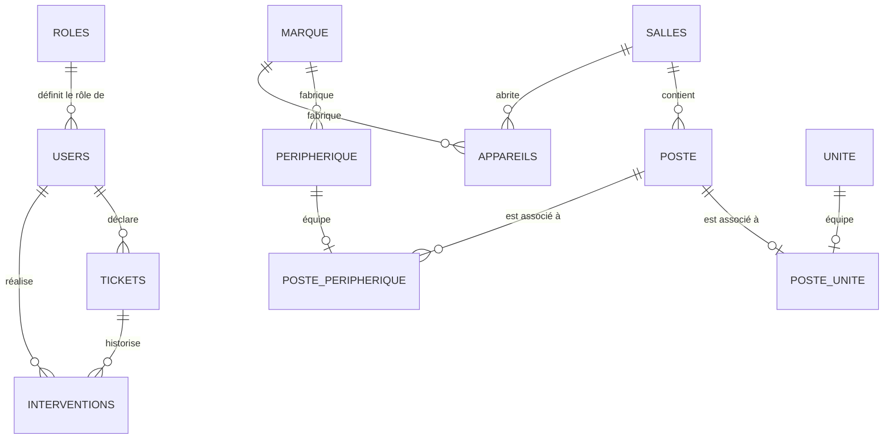

# 🖥️ Système de Gestion de Parc Informatique & Helpdesk (GPI)

Bienvenue dans le dépôt du projet **GPI (Gestion de Parc Informatique)**. Ce projet est une solution web complète pour l'inventaire, le suivi, l'affectation, l'archivage du matériel informatique et la gestion d'un centre de services / tickets d'incidents (Helpdesk) multi-rôles.

---

## 📋 Table des matières

1. [Aperçu du Projet](#-aperçu-du-projet)
2. [Technologies et Langages Utilisés](#-technologies-et-langages-utilisés)
3. [Base de Données (MySQL)](#-base-de-données-mysql)
   - [Schéma et Architecture des Tables](#schéma-et-architecture-des-tables)
   - [Détail des 15 Tables](#détail-des-15-tables)
   - [Rôles et Droits Prédéfinis](#rôles-et-droits-prédéfinis)
   - [Gestion de l'Archivage et Traçabilité](#gestion-de-larchivage-et-traçabilité)
4. [Architecture et Organisation des Pages](#-architecture-et-organisation-des-pages)
   - [Page d'Accueil & Authentification](#page-daccueil--authentification)
   - [Pages Administrateur (`pages/admin/`)](#pages-administrateur-pagesadmin)
   - [Pages Communes / Gestion du Parc (`pages/common/`)](#pages-communes--gestion-du-parc-pagescommon)
   - [Pages Utilisateurs Standard (`pages/user/`)](#pages-utilisateurs-standard-pagesuser)
   - [Signalement par Salle / Borne (`pages/tickets_par_salle/`)](#signalement-par-salle--borne-pagestickets_par_salle)
   - [Module d'Archivage (`pages/archives/`)](#module-darchivage-pagesarchives)
   - [Fichiers Utilitaires (`includes/`)](#fichiers-utilitaires-includes)
5. [Matrice des Droits d'Accès par Rôle](#-matrice-des-droits-daccès-par-rôle)
6. [Sécurité et Bonnes Pratiques](#-sécurité-et-bonnes-pratiques)
7. [Guide d'Installation Rapide](#-guide-dinstallation-rapide)

---

## 🚀 Aperçu du Projet

Le système **GPI** a été conçu pour répondre aux besoins d'organisation et de maintenance informatique au sein d'une structure éducative ou administrative. Il permet :
- La cartographie physique du matériel (par étage, salle, poste de travail).
- La gestion granulaire des composants (unités centrales, périphériques, imprimantes, projecteurs).
- L'émission et le traitement des tickets d'incidents informatiques avec suivi des interventions techniques.
- La génération d'étiquettes / QR Codes pour identifier rapidement un poste ou une salle.
- L'export des inventaires aux formats CSV et Excel (XLSX).

---

## 💻 Technologies et Langages Utilisés

| Technologie / Langage | Utilisation principale |
| :--- | :--- |
| **PHP (7.4 / 8.x)** | Logique backend, contrôleurs de pages, traitement des formulaires, sessions utilisateur, authentification. |
| **MySQL / MariaDB** | Base de données relationnelle (moteur InnoDB, clés étrangères, contraintes d'intégrité, colonnes virtuelles). |
| **HTML5 & CSS3** | Structure sémantique des pages, feuilles de styles personnalisées (`custom.css`, `dashboard.css`). |
| **Bootstrap 4 / 5** | Framework CSS responsive pour l'ergonomie, la grille, les cartes et les formulaires. |
| **JavaScript / jQuery 3.6** | Interactions dynamiques légères, gestion des menus déroulants et composants interactifs. |
| **Font Awesome 5 & Bootstrap Icons** | Iconographie moderne pour l'ensemble des modules et interfaces. |
| **PHPQRCode** | Bibliothèque intégrée dans `includes/` pour la génération autonome de QR Codes d'inventaire. |
| **PHP_XLSXWriter** | Bibliothèque PHP légère (`xlsxwriter.class.php`) pour l'export Excel sans dépendances lourdes. |

---

## 🗄️ Base de Données (MySQL)

Le fichier SQL d'initialisation se trouve à la racine : [`gpii.sql`](gpii.sql).  
La base de données par défaut se nomme `gpii` et utilise l'encodage `utf8mb4_unicode_ci`.

### Schéma et Architecture des Tables

La base comprend **15 tables** organisées en quatre pôles :
1. **Comptes & Droits** : `users`, `roles`
2. **Gestion du Parc** : `salles`, `marque`, `unite`, `peripherique`, `poste`, `poste_unite`, `poste_peripherique`, `appareils`
3. **Helpdesk & Maintenance** : `tickets`, `interventions`
4. **Historique & Traçabilité** : `archives_unite`, `archives_peripherique`, `archives_appareils`



---

### Détail des 15 Tables

#### 1. `users`
Stocke l'ensemble des comptes utilisateurs de l'application.
- `id_user` *(INT, PK, Auto-increment)* : Identifiant unique de l'utilisateur.
- `prenom` *(VARCHAR 100)* : Prénom de l'utilisateur.
- `nom` *(VARCHAR 100)* : Nom de famille.
- `email` *(VARCHAR 255, UNIQUE)* : Adresse de messagerie (identifiant de connexion).
- `password` *(VARCHAR 255)* : Mot de passe chiffré via l'algorithme `password_hash()` (Bcrypt).
- `id_role` *(INT, FK -> `roles.id_role`)* : Rôle attribué à l'utilisateur.
- `date_created` *(TIMESTAMP)* : Date de création du compte.
- `code_utilisateur` *(VARCHAR 6, UNIQUE)* : Code interne généré (ex: `SAHO05`).

#### 2. `roles`
Définit les niveaux de privilèges au sein du système.
- `id_role` *(INT, PK, Auto-increment)* : Identifiant du rôle.
- `role_name` *(VARCHAR 50, UNIQUE)* : Intitulé du rôle (`Admin`, `Technicien`, `Chargé de formation`, `Professeur`, `Agent administratif`).

#### 3. `salles`
Répertoire des emplacements physiques (salles informatiques, bureaux, laboratoires).
- `id_salle` *(INT UNSIGNED, PK, Auto-increment)* : Identifiant unique de la salle.
- `nom_salle` *(VARCHAR 50)* : Nom ou numéro de la salle (ex: `Salle 201`, `Labo réseau`).
- `etage` *(ENUM '2', '3')* : Étage du bâtiment.
- `groupe` *(ENUM 'Administratif', 'Etude', 'Cisco')* : Catégorie d'affectation de la salle.
- *Contrainte* : Clé unique sur le couple `(nom_salle, etage)`.

#### 4. `marque`
Catalogue des constructeurs d'équipements informatiques.
- `id_marque` *(INT, PK, Auto-increment)* : Identifiant de la marque.
- `nom_marque` *(VARCHAR 255, UNIQUE)* : Nom de la marque (HP, Dell, Lenovo, Acer, Canon, Epson, etc.).

#### 5. `unite`
Inventaire détaillé des unités centrales / ordinateurs de bureau.
- `id_unite` *(INT, PK, Auto-increment)* : Identifiant unique de l'unité.
- `numero_inventaire` *(VARCHAR 255, UNIQUE)* : Numéro d'inventaire physique étiqueté.
- `ram` *(ENUM '2 GB', '4 GB', '8 GB', '16 GB', '32 GB', '64 GB')* : Capacité de la mémoire vive.
- `processeur` *(ENUM 'INTEL_CORE_I3', 'INTEL_CORE_I5', 'INTEL_CORE_I7', 'INTEL_CORE_I9', 'INTEL_XEON', 'INTEL_PENTIUM', 'INTEL_CELERON')* : Type de processeur.
- `disque_dur_1_type` *(ENUM 'SSD', 'HDD')* : Technologie du disque principal.
- `disque_dur_1_capacite` *(ENUM '70 GB', '120 GB', '500 GB')* : Capacité du disque 1.
- `disque_dur_2_type` *(ENUM 'SSD', 'HDD', NULL)* : Technologie du disque secondaire optionnel.
- `disque_dur_2_capacite` *(ENUM '70 GB', '120 GB', '500 GB', NULL)* : Capacité du disque 2.
- `etat` *(ENUM 'Operationnel', 'En panne')* : État de fonctionnement du matériel.
- `date_achat` *(DATE)* : Date d'acquisition de la machine.
- `date_ajout` *(DATETIME)* : Date d'enregistrement dans le système.
- `supprime_le` *(DATETIME, NULL)* : Horodatage en cas de suppression logique.
- `est_affecte` *(TINYINT 1)* : Indicateur d'assignation à un poste de travail (0 ou 1).

#### 6. `peripherique`
Gestion des périphériques individuels connectés ou en stock.
- `id_peripherique` *(INT, PK, Auto-increment)* : Identifiant unique.
- `type` *(ENUM 'Clavier', 'Souris', 'Ecran')* : Nature de l'équipement.
- `id_marque` *(INT, FK -> `marque.id_marque`)* : Fabricant de l'accessoire.
- `numero_inventaire` *(VARCHAR 255, UNIQUE)* : Numéro d'inventaire unique.
- `etat` *(ENUM 'Operationnel', 'En panne')* : État de santé.
- `date_ajout` *(DATETIME)* : Date d'entrée dans le parc.
- `supprime_le` *(DATETIME, NULL)* : Date de suppression logique.
- `est_affecte` *(TINYINT 1)* : `1` si lié à un poste, sinon `0`.

#### 7. `poste`
Représente un poste de travail complet situé dans une salle précise.
- `id_poste` *(INT, PK, Auto-increment)* : Identifiant du poste.
- `nom_poste` *(VARCHAR 255)* : Nom du poste (ex: `POSTE-01`, `PC-ACCUEIL`).
- `id_salle` *(INT UNSIGNED, FK -> `salles.id_salle`)* : Salle dans laquelle se situe le poste.
- `date_creation` *(DATETIME)* : Date de mise en place.
- `etat` *(ENUM 'opérationnel', 'en_panne')* : Statut global du poste de travail.
- *Contrainte* : Clé unique sur le couple `(nom_poste, id_salle)`.

#### 8. `poste_unite`
Table d'association stricte 1-à-1 entre un poste de travail et une unité centrale.
- `id_poste` *(INT, PK, UNIQUE, FK -> `poste.id_poste`)*.
- `id_unite` *(INT, PK, UNIQUE, FK -> `unite.id_unite`)*.

#### 9. `poste_peripherique`
Table de liaison entre un poste et ses différents périphériques (écran, clavier, souris).
- `id_poste` *(INT, PK, FK -> `poste.id_poste`)*.
- `id_peripherique` *(INT, PK, UNIQUE, FK -> `peripherique.id_peripherique`)*.

#### 10. `appareils`
Gestion des équipements partagés autonomes (imprimantes et projecteurs).
- `id_appareil` *(INT, PK, Auto-increment)* : Identifiant unique de l'appareil.
- `type` *(ENUM 'Imprimante', 'Projecteur')* : Type d'appareil.
- `modele` *(VARCHAR 100)* : Référence constructeur / modèle.
- `numero_inventaire` *(VARCHAR 50, UNIQUE)* : Numéro d'inventaire.
- `etat` *(ENUM 'Operationnel', 'En panne')* : Disponibilité.
- `id_marque` *(INT, FK -> `marque.id_marque`)* : Marque.
- `id_salle` *(INT UNSIGNED, NULL, FK -> `salles.id_salle`)* : Salle d'affectation.
- `date_ajout` *(TIMESTAMP)* : Date d'ajout.
- `supprime_le` *(TIMESTAMP, NULL)* : Date de mise au rebut / suppression.
- `est_affecte` *(TINYINT 1 VIRTUAL)* : Colonne virtuelle générée automatiquement : `(`id_salle` is not null)`.

#### 11. `tickets`
Gestion des demandes d'assistance et signalements d'incidents techniques.
- `id_ticket` *(INT, PK, Auto-increment)* : Numéro unique du ticket.
- `id_user` *(INT, FK -> `users.id_user`)* : Auteur du signalement.
- `id_salle` *(INT UNSIGNED, NULL, FK -> `salles.id_salle`)* : Salle concernée.
- `id_poste` *(INT, NULL, FK -> `poste.id_poste`)* : Poste spécifique en panne (optionnel).
- `id_appareil` *(INT, NULL, FK -> `appareils.id_appareil`)* : Imprimante ou projecteur concerné (optionnel).
- `id_peripherique` *(INT, NULL, FK -> `peripherique.id_peripherique`)* : Périphérique concerné (optionnel).
- `id_unite` *(INT, NULL, FK -> `unite.id_unite`)* : Unité centrale en cause (optionnel).
- `description` *(TEXT)* : Description détaillée du problème rencontré.
- `priorite` *(ENUM 'Haute', 'Moyenne', 'Faible')* : Niveau d'urgence.
- `etat` *(ENUM 'Ouvert', 'En cours', 'Probleme Résoulu(fermé)', 'probleme non resoulu(fermé)')* : Cycle de vie du ticket.
- `categorie` *(ENUM 'Matériel', 'Logiciel', 'Réseau', 'Demande')* : Classification de l'incident.
- `date_creation` *(TIMESTAMP)* : Date et heure de soumission.

#### 12. `interventions`
Journal d'actions techniques associées aux tickets d'incidents.
- `id_intervention` *(INT, PK, Auto-increment)* : Identifiant de l'intervention.
- `id_ticket` *(INT, FK -> `tickets.id_ticket`)* : Ticket cible.
- `id_user` *(INT, FK -> `users.id_user`)* : Technicien ou administrateur ayant opéré.
- `description` *(TEXT)* : Diagnostic ou constat.
- `action_effectuee` *(TEXT)* : Détail des réparations, réglages ou remplacements effectués.
- `date_intervention` *(TIMESTAMP)* : Horodatage de l'action.

#### 13. `archives_unite`
Table d'archivage des unités centrales supprimées (sauvegarde d'audit avant suppression physique).
- Champs : `id_archive`, `id_unite`, `numero_inventaire`, `ram`, `processeur`, caractéristiques disques 1 et 2, `etat`, `date_achat`, `date_ajout`, `supprime_le`, `est_affecte`, `date_archive`.

#### 14. `archives_peripherique`
Table d'archivage des périphériques retirés du parc actif.
- Champs : `id_archive`, `id_peripherique`, `type`, `id_marque`, `nom_marque`, `numero_inventaire`, `etat`, `date_ajout`, `supprime_le`, `est_affecte`, `date_archive`.

#### 15. `archives_appareils`
Table d'archivage des imprimantes et vidéoprojecteurs réformés ou supprimés.
- Champs : `id_archive`, `id_appareil`, `type`, `modele`, `numero_inventaire`, `etat`, `id_marque`, `nom_marque`, `id_salle`, `nom_salle`, `date_ajout`, `date_archive`.

---

## 📂 Architecture et Organisation des Pages

```
gpii_2/
├── index.php                      # Connexion & Authentification principale
├── gpii.sql                       # Script de création & données de la base MySQL
├── structure_du_projet.html       # Présentation graphique de l'architecture
├── acces_roles.html               # Tableau récapitulatif des habilitations
├── assets/
│   └── css/                       # Feuilles de style (Bootstrap, custom, dashboard)
├── includes/                      # Cœur applicatif, fonctions et librairies
│   ├── functions.php              # Fonctions globales (connexion PDO, en-têtes, sécurité)
│   ├── gestion.php                # Opérations CRUD matériel & associations
│   ├── filters.php                # Moteurs de recherche et filtres
│   ├── views.php                  # Vues HTML et tableaux réutilisables
│   ├── export.php                 # Logique d'exportation de données (Excel/CSV)
│   ├── init_admin.php             # Assistant de création du 1er compte administrateur
│   ├── logout.php                 # Déconnexion et destruction de session
│   ├── xlsxwriter.class.php       # Librairie export Excel
│   └── phpqrcode.php / qrlib.php  # Librairie de génération de QR codes
└── pages/
    ├── admin/                     # Modules réservés aux administrateurs
    ├── common/                    # Modules de gestion opérationnelle (Admin & Techniciens)
    ├── user/                      # Espace pour les utilisateurs standards
    ├── tickets_par_salle/         # Interface dédiée au signalement par salle / poste
    └── archives/                  # Gestion des équipements déclassés / archivés
```

---

### Page d'Accueil & Authentification

- **`index.php`** :
  - Formulaire de connexion sécurisé (email + mot de passe).
  - Contrôle des identifiants avec `password_verify()` sur hash Bcrypt.
  - Régénération de l'ID de session (`session_regenerate_id(true)`) contre la fixation de session.
  - Redirection automatique selon le rôle :
    * **Admin / Technicien** -> `pages/common/dahbord.php`
    * **Utilisateur standard** -> `pages/user/create_ticket.php`

---

### Pages Administrateur (`pages/admin/`)

Ces pages nécessitent le rôle **Administrateur (`id_role = 1`)** :

- **`gestion_users.php`** :
  - Tableau de bord de l'ensemble des comptes utilisateurs.
  - Filtrage par rôle, recherche nominative ou par code utilisateur.
  - Actions pour modifier les droits ou supprimer des utilisateurs non-administrateurs.
- **`ajouter_user.php`** :
  - Formulaire de création d'un utilisateur avec validation des données.
  - Hachage automatique du mot de passe.
  - Génération d'un trigramme / code utilisateur unique automatique.
- **`modifier_user.php`** :
  - Édition des données d'un compte (nom, prénom, adresse e-mail, attribution du rôle).
  - Possibilité de réinitialiser le mot de passe de façon sécurisée.
- **`gestion_references.php`** :
  - Gestion du catalogue des marques (ajout, renommage, suppression).
  - Gestion des salles du parc (ajout de salle, assignation à un étage et à un groupe).
- **`manage_tickets.php`** :
  - Vue d'ensemble Helpdesk pour superviser l'ensemble des tickets ouverts.
  - Filtrage multicritères (statut, priorité, catégorie, localisation).
  - Prise en charge rapide, changement d'état, attribution et accès aux détails.
- **`ticket_details.php`** :
  - Fiche détaillée d'un ticket avec historique complet des interventions techniques réalisées.
  - Formulaire d'ajout d'intervention avec modification synchrone du statut du ticket (Résolu, En cours, etc.).
- **`statistiques.php`** :
  - Métriques clés et indicateurs de performance (KPI) du parc informatique.
  - Graphiques de répartition des pannes par catégorie, salle et type de matériel.
  - Taux de résolution et temps moyen de traitement.

---

### Pages Communes / Gestion du Parc (`pages/common/`)

Accessibles aux **Administrateurs (`id_role = 1`)** et **Techniciens (`id_role = 2`)** :

- **`dahbord.php`** :
  - Tableau de bord principal avec compteurs en temps réel (nombre total de postes, unités, périphériques, appareils).
  - Indicateur des tickets en souffrance, alertes sur matériel en panne et raccourcis rapides.
- **`views_all.php`** :
  - Vue consolidée et exhaustive de l'ensemble du parc informatique.
  - Filtres croisés par salle, catégorie d'équipement, marque et statut opérationnel.
  - Boutons d'export des données vers Excel (`.xlsx`) ou CSV.
- **`Gestion_unit.php`** :
  - Gestion des unités centrales : inventaire, saisie des configurations (CPU, RAM, Disques), affectation à un poste ou mise en réserve.
  - Enregistrement des pannes et archivage.
- **`gestion_peripherique.php`** :
  - Gestion des écrans, claviers et souris : suivi du statut affecté / disponible, test de bon fonctionnement, suppression avec archivage.
- **`gestion_poste.php`** :
  - Gestion des postes de travail : association d'une unité centrale et de ses périphériques pour créer un poste prêt à l'emploi dans une salle définie.
- **`Gestion_appareil.php`** :
  - Gestion du matériel mutualisé (imprimantes réseau, vidéoprojecteurs) : liaison avec la marque, la salle et suivi de l'état.

---

### Pages Utilisateurs Standard (`pages/user/`)

Destinées aux enseignants, chargés de formation et agents administratifs :

- **`create_ticket.php`** :
  - Formulaire intuitif pour déclarer un dysfonctionnement informatique.
  - Choix guidé de la localisation (salle), du poste ou de l'appareil en cause.
  - Définition de la priorité et de la catégorie de panne (matériel, réseau, logiciel).

---

### Signalement par Salle / Borne (`pages/tickets_par_salle/`)

Module conçu pour être utilisé via borne tactile, tablette ou suite au scan d'un QR code disposé dans une salle :

- **`selection_page.php`** :
  - Visualisation des salles et de leurs postes de travail avec leur statut actuel (opérationnel ou en panne).
- **`create_tik_salle.php`** :
  - Déclaration rapide d'incident pré-remplie avec le numéro de salle ou de poste sélectionné.

---

### Module d'Archivage (`pages/archives/`)

Garantit la traçabilité sans perte définitive de données :

- **`archives_unite.php`** : Consultation et restauration des unités centrales sorties de l'inventaire actif.
- **`archives_peripherique.php`** : Historique des périphériques réformés.
- **`archives_appareil.php`** : Historique des imprimantes et projecteurs archivés.

---

### Fichiers Utilitaires (`includes/`)

- **`functions.php`** : Cœur de l'application : initialisation de la base (`connectDB()`), gestion des en-têtes HTML dynamiques (`afficherHeader()`, `afficherFooter()`), vérification des droits (`estConnecte()`, `estAdmin()`), génération de sessions sécurisées.
- **`gestion.php`** : Fonctions de traitement de données (requêtes d'insertion, mise à jour, liaison de matériel, transactions SQL).
- **`filters.php`** : Moteur de filtres et de pagination des résultats de recherche.
- **`views.php`** : Générateurs de composants visuels (cartes, badges de statuts, formulaires).
- **`export.php`** : Exportation automatisée des tables au format tableur.
- **`init_admin.php`** : Permet la création du tout premier compte administrateur si la table `users` est vide.
- **`logout.php`** : Déconnexion sécurisée de la session courante.

---

## 🔐 Matrice des Droits d'Accès par Rôle

| Type de page | Visiteur | Enseignant / Agent (`roles 3, 4, 5`) | Technicien (`role 2`) | Administrateur (`role 1`) |
| :--- | :---: | :---: | :---: | :---: |
| **`index.php` (Connexion)** | ✅ Oui | 🔄 Redirection | 🔄 Redirection | 🔄 Redirection |
| **`dahbord.php` (Tableau de bord)** | ❌ Non | ❌ Non | ✅ Oui | ✅ Oui |
| **`views_all.php` (Vue globale)** | ❌ Non | ✅ Consultation | ✅ Oui | ✅ Oui |
| **Gestion du Matériel (`Gestion_*.php`)** | ❌ Non | ❌ Non | ✅ Oui | ✅ Oui |
| **Création de ticket (`create_ticket.php`)** | ❌ Non | ✅ Oui | ✅ Oui | ✅ Oui |
| **Gestion des tickets & Interventions** | ❌ Non | ❌ Non | ✅ Oui | ✅ Oui |
| **Archives du matériel** | ❌ Non | ❌ Non | ✅ Oui | ✅ Oui |
| **Gestion des Utilisateurs** | ❌ Non | ❌ Non | ❌ Non | ✅ Oui |
| **Gestion des Références (Marques/Salles)**| ❌ Non | ❌ Non | ❌ Non | ✅ Oui |
| **Statistiques globales** | ❌ Non | ❌ Non | ❌ Non | ✅ Oui |

---

## 🛡️ Sécurité et Bonnes Pratiques

- **Protection contre les injections SQL** : 100 % des requêtes à paramètres variables utilisent des **requêtes préparées PDO** avec liaison de paramètres (`execute([...])`).
- **Protection contre les failles XSS** : Nettoyage systématique des sorties HTML via `htmlspecialchars($val, ENT_QUOTES, 'UTF-8')`.
- **Hachage sécurisé des mots de passe** : Utilisation de l'API standard PHP `password_hash($password, PASSWORD_DEFAULT)` et `password_verify()`.
- **Sécurité des sessions** :
  - Régénération de l'identifiant de session (`session_regenerate_id(true)`) à la connexion pour contrecarrer les attaques de fixation de session.
  - Paramètres de cookies de session restreints (`HttpOnly`, `SameSite`).
- **Suppression logique & Archivage** : Les équipements retirés du parc actif sont archivés dans des tables dédiées avant suppression, assurant un audit complet.

---

## 🛠️ Guide d'Installation Rapide

### Prérequis
- Un serveur web local (**WampServer**, **XAMPP** ou **LAMP**) avec :
  - PHP 7.4 ou supérieur (extensions `pdo_mysql`, `gd`, `mbstring` activées).
  - MySQL 5.7+ ou MariaDB 10.3+.

### Étapes d'installation

1. **Cloner ou placer le projet dans le répertoire web :**
   ```bash
   # Pour WampServer (par exemple sous C:\wamp64\www\gpii_2)
   cd C:\wamp64\www
   git clone https://github.com/hctsamyUCT/GPI_uca.git gpii_2
   ```

2. **Créer et importer la base de données :**
   - Ouvrez phpMyAdmin (`http://localhost/phpmyadmin`).
   - Créez une nouvelle base de données nommée **`gpii`** avec l'interclassement `utf8mb4_unicode_ci`.
   - Cliquez sur **Importer** et sélectionnez le fichier [`gpii.sql`](gpii.sql).

3. **Vérifier la configuration de connexion :**
   - Ouvrez [`includes/functions.php`](includes/functions.php).
   - Ajustez les identifiants MySQL dans la fonction `connectDB()` si nécessaire :
     ```php
     $host = 'localhost';
     $db   = 'gpii';
     $user = 'root';
     $pass = ''; // mot de passe de votre serveur MySQL local
     ```

4. **Accéder à l'application :**
   - Lancez votre navigateur et rendez-vous sur :
     `http://localhost/gpii_2/index.php`
   - Vous pouvez vous connecter avec les comptes de test présents dans la base ou initialiser un administrateur via `includes/init_admin.php`.

---

Développé dans le cadre de la gestion et du suivi des parcs informatiques universitaires et administratifs.
